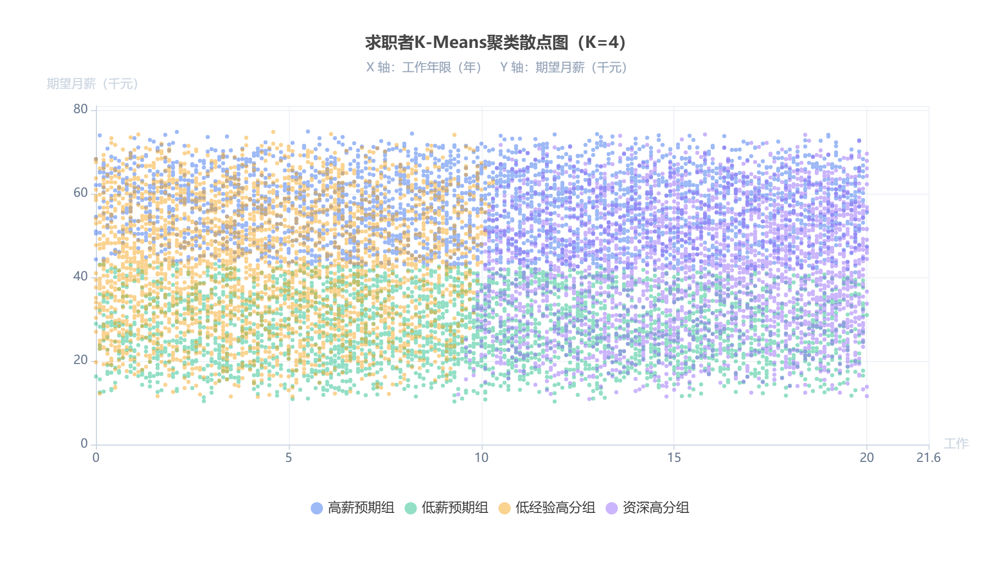
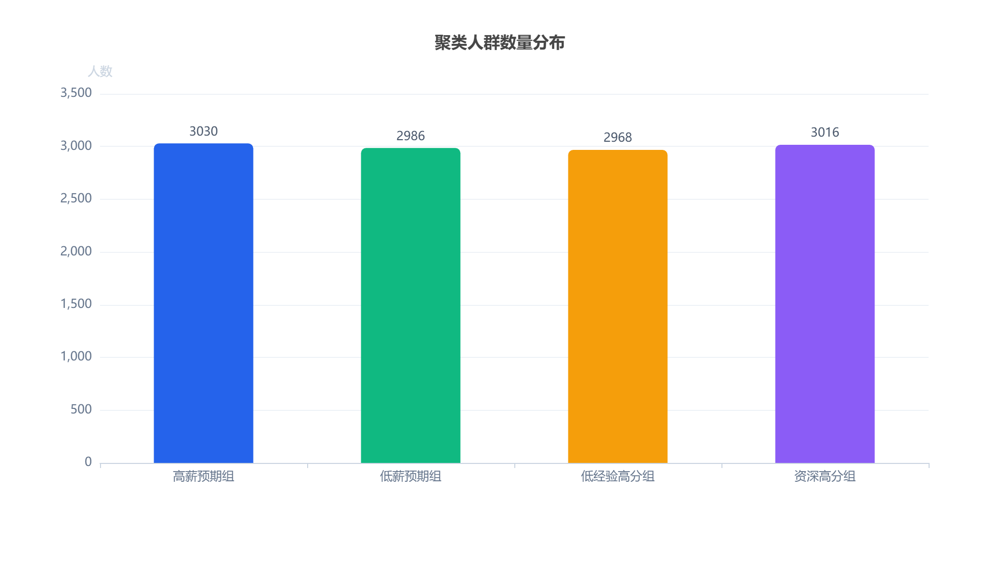

# 大数据招聘岗位数据分析

> 求职者画像聚类与求职竞争力分析 · 基于 **12,000 条** Kaggle 招聘候选人数据
> 覆盖「数据清洗 → MySQL 入库 → EDA → K-Means 聚类 → ECharts 可视化」完整数据分析闭环

**项目作品集 · 作者：大数据技术（专科）大三学生 · 目标岗位：初级数据分析 / 大数据助理**

---

## 快速导航

| 内容 | 入口 |
| --- | --- |
| 📄 完整项目报告（含全部图表与解读） | [docs/report.md](docs/report.md) |
| 📊 分析主数据集 | [data/data_cleaned.csv](data/data_cleaned.csv) |
| 📌 K-Means 聚类结果 | [data/candidate_kmeans_result.csv](data/candidate_kmeans_result.csv) |
| 🖼️ 图表静态图 | [assets/](assets/) |

---

## 项目简介

本人为专科大数据技术专业大三学生，目标求职初级数据分析、大数据助理岗位。本项目以 Kaggle 国内招聘候选人公开数据集为基础，完整复刻企业数据分析工作闭环：

```
数据源读取 → Pandas 数据清洗 → 数据入库 MySQL → EDA 探索性分析
→ K-Means 聚类建模 → ECharts 可视化 → 业务解读与报告输出
```

项目一方面锻炼数据分析实战能力；另一方面挖掘求职者分层特征，为个人学习规划、简历优化、岗位投递策略提供**基于数据而非直觉**的支撑。

---

## 核心发现（全部由 data_cleaned.csv 实算）

1. **期望薪资与工作年限几乎不相关**（Pearson r = 0.003）：0–2 年组期望月薪中位 43,430 元，10 年以上组 43,060 元，基本持平；同一经验段内薪资跨度可达 6 倍 → 拉开差距的是岗位类型、城市与个人呈现，而非年限本身。
2. **K-Means（K=4）识别出四类求职者画像**：高薪预期组（3,030 人）、低薪预期组（2,986 人）、低经验高分组（2,968 人）、资深高分组（3,016 人），每组各约 25%。
3. **学历与城市分布接近均匀**（六类学历占比 16.0%–17.9%，Top10 城市 9.5%–10.5%）——数据为均衡采样，报告中对结论范围做了如实限定。

## 技术栈

| 环节 | 工具 |
| --- | --- |
| 数据处理 | Python · Pandas |
| 数据存储 | MySQL |
| 统计建模 | Scikit-learn（StandardScaler · K-Means · 手肘法 / 轮廓系数） |
| 可视化 | Matplotlib（验证）→ ECharts（成品） |
| 展示 | Markdown · GitHub Pages |

---

## 图表预览

### 求职者 K-Means 聚类散点图（核心建模，K=4）



### 聚类人群数量分布



> 更多图表（学历 / 薪资 / 年限 / 城市）见 [完整报告](docs/report.md)。GitHub Pages 不执行 JavaScript，故图表以静态 PNG 呈现；交互式 HTML 版可本地打开。

---

## 仓库结构

```
├── README.md                        # 本文件（仓库首页）
├── index.md                         # GitHub Pages 站点入口页
├── _config.yml                      # Jekyll 站点配置
├── docs/
│   └── report.md                    # 完整项目报告（Markdown）
├── assets/
│   ├── chart_edu.png                # 图1 学历分布
│   ├── chart_salary.png             # 图2 期望薪资分布
│   ├── chart_exp.png                # 图3 工作年限分布
│   ├── chart_city.png               # 图4 意向城市热度 Top10
│   ├── chart_cluster_scatter.png    # 图5 K-Means 聚类散点图（K=4）
│   └── chart_cluster_bar.png        # 图6 聚类人群数量分布
└── data/
    ├── data_cleaned.csv             # 清洗后主数据集（12,000 × 29）
    └── candidate_kmeans_result.csv  # 聚类结果（12,000 × 31）
```

---

## 复现说明

1. 所有统计数字均可由 `data/data_cleaned.csv` 与 `data/data_candidate_kmeans_result.csv` 全量计算复现；
2. 聚类使用【工作年限、期望月薪、简历评分】3 个特征，`StandardScaler` 标准化后执行 K-Means（对比 K=2–6，SSE 降幅在 K=4 后趋缓，四类画像业务可解释性最佳）；
3. 报告对数据集局限（均衡采样、候选人侧而非岗位 JD、静态时效）做了如实说明，未做样本外推断。

---

## 联系

本项目为求职作品集内容，欢迎就数据处理、聚类建模、业务解读任何环节交流探讨。
