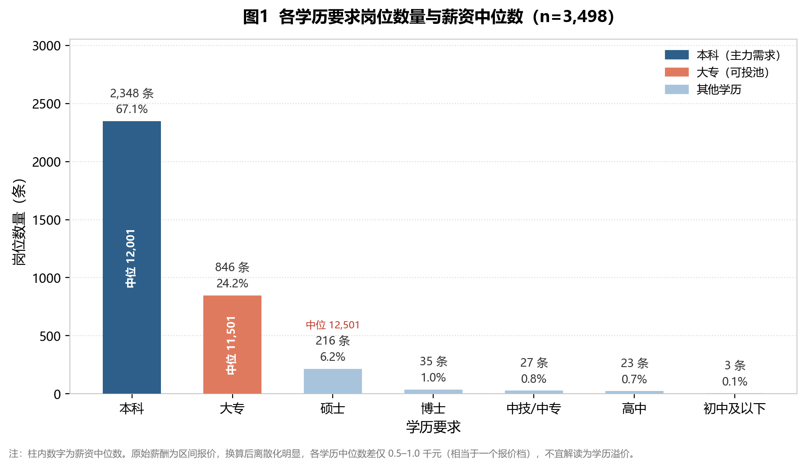
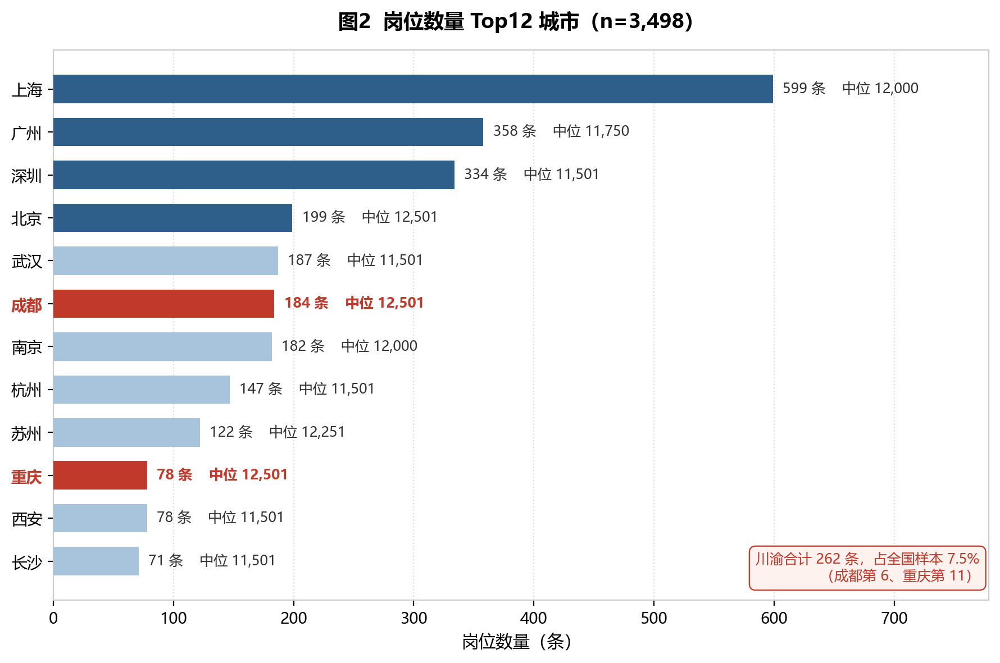
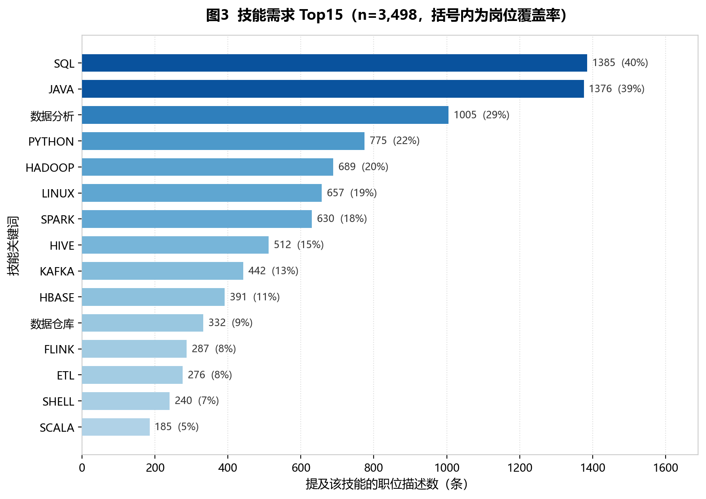
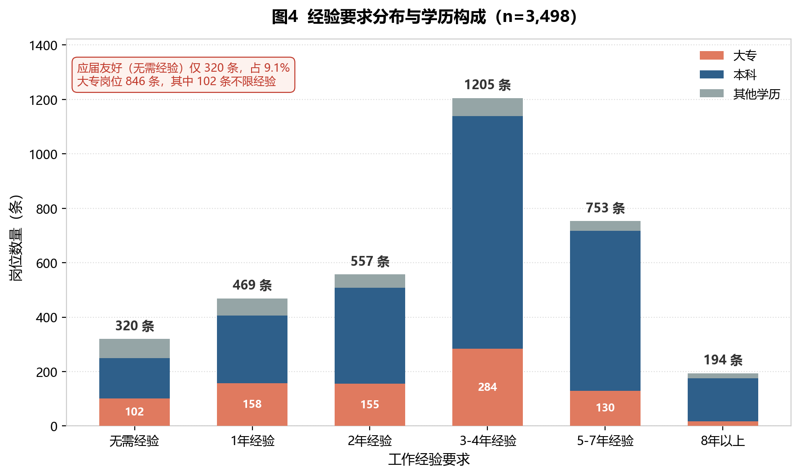

# 大数据岗位分析 · 求职作品集

一名**大数据技术专业（专科）大三**学生的数据分析作品集。

做的事情很简单：不靠感觉投简历，先用公开招聘数据把市场看清楚——**我这种学历能投哪些岗位、该按什么顺序补技能、目标城市的机会量到底有多大**。两个项目分别从「岗位供给侧」和「求职者需求侧」切入，形成互补。


---

## 项目一览

| # | 项目 | 数据规模 | 核心方法 | 主要产出 |
|---|---|---|---|---|
| ① | **大数据招聘岗位数据分析**（主项目） | 4,100 条岗位 → 清洗后 3,498 条 | 数据清洗 · 分组聚合 · 四维可视化 | [完整报告](REPORT.md) · [PDF](assets/report_full.pdf) |
| ② | 求职者画像聚类分析 | 12,000 条候选人 | K-Means 聚类 · 相关性分析 | [项目报告](docs/report.md) |

---

## 主项目 ①：大数据招聘岗位数据分析

> 从 4,100 条带脏值的原始招聘数据，到 3,498 条可分析样本，再到 4 张图与 4 条可执行结论——完整走了一遍数据分析的真实链路。

**数据**：和鲸社区公开数据集（全国「大数据开发」方向岗位快照，2022-11，4,100 行 × 15 字段，44 类职位、69 家公司）
**技术栈**：Python · Pandas · NumPy · Matplotlib
**流程**：质量诊断 → 去重 → 结构化回填 → 脏值清洗 → 类型转换 → 异常值标记 → 分组聚合 → 可视化

### 清洗做了什么

| 环节 | 处理 | 结果 |
|---|---|---|
| 去重 | 整行去重 602 条；并用业务主键二次校验（不按「公司+职位名」去重，否则会错删到 77 条） | 4,100 → **3,498** |
| 缺失回填 | 用 100% 可解析的 `地区经验学历` 结构化列回填学历/经验/城市 | 学历缺失 476 → **0**，经验 475 → 1 |
| 脏值清洗 | 白名单过滤混入的发布日期串（如「11-16发布」），统一转义符 | 枚举干净 |
| 类型转换 | 6 类混乱薪酬写法（`8千-1.2万` / `15-20万/年` / `1.5-2万·13薪` …）→ 月薪下限/上限/中点 | 薪酬可用率 **98.0%** |
| 异常值 | 领域兜底剔除单位错误（触发 0 条）+ IQR 诊断，363 条离群高薪**保留不删** | 保留真实高薪样本，右偏用中位数应对 |

### 四条核心结论

| 结论 | 数据支撑 |
|---|---|
| **学历卡「入场券」，不卡「工资条」** | 专科可投 899 条（25.7%），74.3% 岗位要求本科以上；但大专中位 11,501 元 vs 本科 12,001 元，仅差 500 元 |
| **川渝要主攻成都、保留异地** | 成都 184 条（全国第 6）、重庆 78 条（第 11），川渝合计仅 7.5%；「大专 + 无需经验」全川渝只有 **6 条** |
| **技能优先级 SQL > Java > Python** | SQL 覆盖率 40%、Java 39%、数据分析 29%、**Python 仅 22%**；Hadoop/Hive/Spark 分别 20%/15%/18% |
| **用项目把经验栏从 0 填到 1** | 要求 3 年以上经验占 61.5%，应届友好岗仅 9.1%；「1 年经验」段 469 条（大专 158 条）是平衡点 |

### 图表预览

**图 1｜各学历要求岗位数量与薪资中位数**



**图 2｜岗位数量 Top12 城市（川渝高亮）**



**图 3｜技能需求 Top15**



**图 4｜经验要求分布与学历构成**



> 每张图的图表说明、读图结论与局限说明见 [完整报告](REPORT.md)。

---

## 项目 ②：求职者画像聚类分析

从**求职者侧**看问题：12,000 条招聘候选人数据（Kaggle 公开集），经 Pandas 清洗、MySQL 入库后做 EDA 与 K-Means 聚类（K=4）。

- 期望薪资与工作年限几乎不相关（Pearson **r = 0.003**）——拉开差距的是岗位类型与个人呈现，而非年限本身
- 聚类识别出四类人群：高薪预期、低薪预期、低经验高分、资深高分，各占约 25%
- 详见 [项目报告](docs/report.md)，图表见 [assets/](assets/)

两个项目的关系：② 看「人」的分布，① 看「岗」的要求；① 更能直接指导投递决策。

---

## 仓库结构

```
.
├── README.md                        # 仓库首页（本文件）
├── REPORT.md                        # ① 完整项目报告（GitHub 直接阅读）
├── index.md                         # GitHub Pages 站点入口
├── _config.yml                      # Jekyll 站点配置
├── docs/
│   ├── project-report.md            # ① 报告（Pages 排版版）
│   ├── visual-analysis.md           # ① 可视化专题页
│   └── report.md                    # ② 求职者画像聚类报告
├── src/
│   ├── bigdata_job_clean_eda.py     # ① 清洗 + EDA 脚本
│   └── job_visualization.py         # ① 四图绘制脚本
├── assets/
│   ├── vis_edu.png / vis_city.png / vis_skill.png / vis_exp.png   # ① 四张图
│   ├── report_full.pdf              # ① 报告 PDF（13 页）
│   └── chart_*.png                  # ② 聚类相关图表
└── data/
    ├── clean_jobs_3498.csv          # ① 清洗后主表（3,498 × 19）
    ├── data_cleaned.csv             # ② 候选人数据（12,000 × 29）
    └── candidate_kmeans_result.csv  # ② 聚类结果
```

---

## 快速开始

```bash
git clone https://github.com/gentle-tj/job-analysis.git
cd job-analysis

pip install pandas numpy matplotlib

# ① 复现清洗（输入原始 CSV，输出清洗主表与 EDA 打印）
python src/bigdata_job_clean_eda.py job_all.csv clean_output

# ① 复现四张图
python src/job_visualization.py data/clean_jobs_3498.csv charts
```

> 原始 `job_all.csv` 未纳入仓库（体积与授权原因），`data/clean_jobs_3498.csv` 为清洗后结果，可直接复现全部图表与统计数字。

---

## 数据边界与局限

写清楚边界，结论才可信。以下三点务必注意：

1. **样本是主题垂直切片**：44 类职位、69 家公司，`大数据开发工程师` 单一名称占 36.3%，技能词频会被模板化 JD 放大，不能外推为「全国大数据岗位需求」。
2. **单时间点快照**：数据集中在 2022-11，不支持趋势类结论。
3. **薪资离散化**：薪酬由区间报价换算，各分组中位数差异普遍小于一个报价档，因此报告只做「量级相当」的表述，不做精细溢价测算。

因此本报告的所有结论限定在「2022 年 11 月、大数据开发方向、本数据集覆盖范围内」。这些局限写在报告里，而不是藏在脚注。

---

## 联系方式

- GitHub：[gentle-tj](https://github.com/gentle-tj)
- 在线作品集：<https://gentle-tj.github.io/job-analysis/>

> 本项目为求职作品集，数据均来自公开渠道，仅用于能力展示与技术交流。
