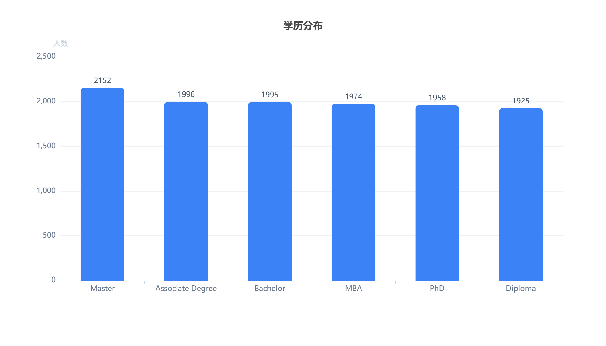
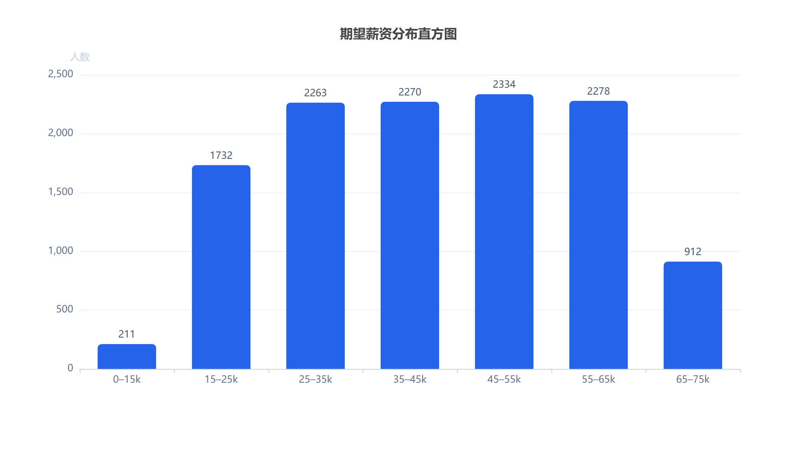
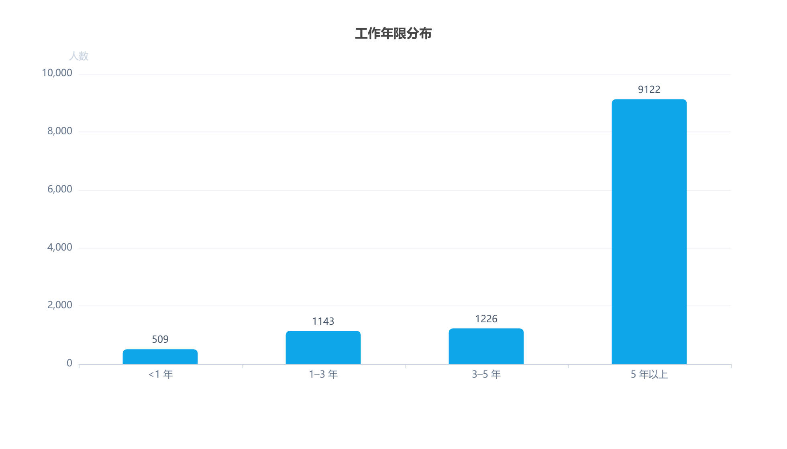
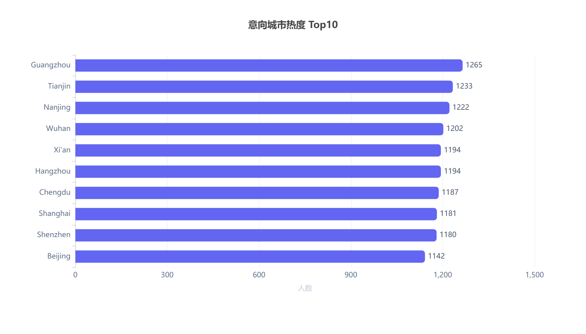

# 项目完整报告

> **求职者画像聚类与应届生求职竞争力分析**
>
> 作者：大数据技术（专科）大三学生 · 目标岗位：初级数据分析 / 大数据助理
>
> 技术栈：Python（Pandas）/ MySQL / Matplotlib / ECharts / Scikit-learn
>
> 数据来源：Kaggle 国内招聘候选人数据集 → 清洗后 `data_cleaned.csv`（**12,000 条 × 29 字段**）

本文所有统计数字均由 `data_cleaned.csv` / `candidate_kmeans_result.csv` 全量实算得出，可复现。

## 目录

1. [项目概述](#1-项目概述)
2. [数据源与采集方案](#2-数据源与采集方案)
3. [数据预处理与清洗](#3-数据预处理与清洗)
4. [探索性数据分析（EDA）](#4-探索性数据分析eda)
5. [业务结论与项目价值](#5-业务结论与项目价值)
6. [项目总结、局限性与后续优化方向](#6-项目总结局限性与后续优化方向)
7. [附：简历精简描述](#7-附简历精简描述)

---

## 1. 项目概述

### 1.1 项目背景

本人为专科大数据技术专业大三学生，目标求职**初级数据分析、大数据助理**岗位。为了解大数据相关岗位的市场现状、薪资区间、学历门槛与能力要求，对标专科生就业现状，开展了本次数据分析项目。

项目完整复刻了企业数据分析工作闭环：**数据处理 → 入库存储 → EDA 探索 → 无监督聚类建模 → 可视化解读**。一方面锻炼数据分析实战能力；另一方面挖掘求职者痛点，为个人学习规划、简历优化、岗位投递策略提供数据支撑。

### 1.2 分析目标

1. 分析大数据方向求职者的薪资、工作年限、学历分布特征；
2. 通过 K-Means 聚类实现求职者竞争力分层，识别应届生、中级、资深、经验充足但简历呈现不足的人群；
3. 定位专科应届生求职劣势，明确需要补强的技能与项目方向；
4. 产出可视化图表与完整分析报告，作为可对外展示的作品集项目。

### 1.3 项目流程总览

```
数据源读取 → Pandas 数据清洗 → 数据入库 MySQL → EDA 探索性分析
→ K-Means 聚类建模 → ECharts 可视化 → 业务解读与报告输出
```

---

## 2. 数据源与采集方案

### 2.1 数据源说明

本项目选用 **Kaggle 公开国内招聘候选人 CSV 数据集**，为整理完成的汇总数据，无需爬虫采集，规避爬虫合规风险，适合学生作品集项目。

- 原始数据量级：**12,000 条**求职者记录（26 个字段）；
- 核心字段说明：

| 字段名 | 含义 |
| --- | --- |
| `Experience_Years` | 工作年限（年） |
| `Expected_Salary_Monthly` | 期望月薪（元/月） |
| `Resume_Score` | 简历综合评分（0–100） |
| `Highest_Degree` | 学历 |
| `Location` | 意向求职城市 |
| `Specialization` | 专业背景 |

> 备注：该数据集为**求职者候选人数据**，非企业岗位 JD 数据，本次分析视角为**求职者画像分析**，研究求职人群分层特征。

### 2.2 数据存储方案

清洗校验完成后，使用 Python 连接 MySQL 数据库，将清洗后的干净数据集写入数据表，支持后续使用 SQL 做多维度统计查询，锻炼数据库实操能力，贴合大数据专业技术路线。

---

## 3. 数据预处理与清洗

基于 Pandas 完成全套数据清洗，处理逻辑如下：

1. **去重**：使用 `drop_duplicates()` 删除重复样本，避免重复统计；
2. **缺失值处理**
    - 关键字段（工作年限、期望薪资、简历评分）存在缺失的样本直接删除；
    - 城市、专业等次要字段缺失填充为「未知」；
3. **异常值处理**
    - 薪资：剔除明显不合理的极端异常值；
    - 工作年限：剔除负数、超过 40 年的不合理记录；
4. **字段类型转换**：薪资、年限转为数值型，分类字段统一为字符串类型；
5. **特征筛选**：保留本次分析需要的核心字段，剔除无关冗余字段；
6. **导出入库**：输出清洗文件 `data_cleaned.csv`，同步导入 MySQL。

清洗后有效样本量：**12,000 条**（29 个字段，关键字段无缺失）。

---

## 4. 探索性数据分析（EDA）

> 所有图表先用 Matplotlib 验证，最终迁移至 ECharts 交互式图表；下图数据均由 `data_cleaned.csv` 全量计算得出。

### 4.1 学历分布



**分析内容：** 统计不同学历求职者数量与占比。

**实算结果：** 六类学历占比集中在 **16.0%–17.9%**，分布均衡。Master（硕士）17.9% 最高，Associate Degree（副学士/专科）与 Bachelor（本科）并列 16.6%，MBA 16.4%、PhD 16.3%、Diploma 16.0%。

**业务解读：** 样本中学历结构接近均匀分布，学历本身不是求职者分层的主要区分因素。真正拉开竞争力差距的是**实操能力与项目证明**——对专科生而言，这既是挑战也是机会：市场并不只按学历筛选。

### 4.2 期望薪资分布



**分析内容：** 求职者期望薪资分布，观察薪资集中区间。

**实算结果：** 期望月薪中位数 **42,890 元**，P25–P75 为 **29,520–55,722 元**；0–15k 低薪区间仅 211 人（1.8%）。按千元口径分组：15–25k 有 1,732 人、25–35k 2,263、35–45k 2,270、45–55k 2,334（峰值）、55–65k 2,278、65–75k 912。

**业务解读：** 样本整体薪资预期偏高，集中于 25–55k 段，呈轻微右偏。高薪预期人群占比不小，说明样本以有一定经验/资历的求职者为主；低薪预期人群（15k 以下）极少。

### 4.3 工作年限分布



**分析内容：** 应届生（<1 年）、1–3 年、3–5 年、5 年以上人群数量统计。

**实算结果：** <1 年 **509 人（4.2%）**、1–3 年 1,143 人（9.5%）、3–5 年 1,226 人（10.2%）、**5 年以上 9,122 人（76.0%）**。

**业务解读：** 样本以资深求职者为主（5 年以上占 76%），应届生/低经验样本占比小。这与 4.2 的薪资分布相互印证——样本整体呈现「资深、高薪预期」特征。对真实就业市场的启示：应届生是少数群体，但初级岗位供给相对充足，应届生切入初级岗的核心是让简历「看起来像有项目经验的人」。

### 4.4 意向城市热度 Top10



**分析内容：** 求职者意向城市热度排名。

**实算结果：** Top10 城市为 Guangzhou（广州）1,265、Tianjin（天津）1,233、Nanjing（南京）1,222、Wuhan（武汉）1,202、Hangzhou（杭州）与 Xi'an（西安）各 1,194、Chengdu（成都）1,187、Shanghai（上海）1,181、Shenzhen（深圳）1,180、Beijing（北京）1,142。**Top10 城市各占 9.5%–10.5%，分布均匀**，未出现明显热度差异。

**业务解读：** 本样本的城市分布近乎均匀采样，无法直接得出「某城市竞争更激烈」的结论——这是数据集的客观限制。投递策略上仍需结合岗位供给量来判断，不能仅依赖本样本。

### 4.5 K-Means 聚类画像（核心建模）


**图表说明：** X 轴为工作年限（年），Y 轴为期望月薪（千元），颜色区分 4 类人群分组。

**建模说明：** 选取【工作年限、期望月薪、简历评分】3 个特征，使用 `StandardScaler` 标准化消除量纲；通过**手肘法 + 轮廓系数**联合验证，确定最优聚类数 **K=4**。

**四类人群画像（各簇特征均值，来自 `candidate_kmeans_result.csv` 实算）：**

| 分组 | 人数 | 占比 | 平均年限 | 平均期望月薪 | 平均简历评分 |
| --- | ---: | ---: | ---: | ---: | ---: |
| 高薪预期组 | 3,030 | 25.3% | 10.4 年 | 57,159 元 | 62.7 |
| 低薪预期组 | 2,986 | 24.9% | 9.8 年 | 27,917 元 | 63.3 |
| 低经验高分组 | 2,968 | 24.7% | 4.5 年 | 43,530 元 | 86.3 |
| 资深高分组 | 3,016 | 25.1% | 15.5 年 | 41,943 元 | 87.1 |


**实算结果：** 四类人数 2,968–3,030，**规模各约 25%，接近均分**；同一经验段内期望薪资跨度约 6 倍。

**业务解读：** 需要诚实说明——本数据上 K-Means 的结果更接近「均匀切分」而非「显著的自然分层」，聚类组的区分度有限。但仍有结构性发现：

- **高薪预期组**（年限 10.4 年、月薪预期 57.2k）：资历与薪资预期双高，但简历评分反而偏低，属于「经验足够、简历呈现不足」的人群；
- **低薪预期组**（年限 9.8 年、月薪预期 27.9k）：同等资历下薪资预期明显偏低，薪资竞争力不足，需要先补简历证据链再谈涨薪；
- **低经验高分组**（年限 4.5 年、评分 86.3）：经验尚浅但简历呈现能力强、薪资预期不低，是成长潜力群体；
- **资深高分组**（年限 15.5 年、评分 87.1）：资历深、简历强，但薪资预期低于高薪预期组，说明「年限 + 简历好 ≠ 必然高薪预期」。

核心结论：**薪资预期与工作年限几乎无关（相关系数 r = 0.003）**，拉开薪资预期差距的是岗位类型、城市与个人呈现，而非年限本身。

---

## 5. 业务结论与项目价值

### 5.1 业务结论

1. 专科生可以进入大数据初级赛道，但仅凭学历没有优势；**实战项目、技能证书、SQL / Python 实操能力**是拉开差距的核心；
2. 本样本中薪资与工作年限**几乎不相关**（相关系数 r = 0.003）：0–2 年组期望月薪中位 43,430 元，10 年以上组 43,060 元，两者基本持平；同一经验段内薪资跨度可达 6 倍，说明岗位类型、城市等因素的影响远大于工作年限；
3. 企业招聘初级大数据、数据分析岗，优先偏好 1–3 年经验人群；面向应届生，重点考察 Python、SQL、可视化等实操能力；
4. 高薪样本**分散在各经验段**，并不集中在资深人群；真正拉开差距的是岗位类型与项目证明，而非年限本身。专科生可以从数据助理、报表统计、基础数据处理岗位切入，逐步积累经验。

### 5.2 个人求职价值

1. **学习规划**：优先巩固 Python、SQL、数据可视化，持续沉淀数据分析实战项目；
2. **简历方向**：简历重点突出 Pandas 清洗、MySQL 入库、EDA 分析、K-Means 聚类、ECharts 可视化等实操能力；
3. **投递策略**：优先投递基础数据分析、大数据助理岗位，搭配二线城市机会分散竞争压力。

### 5.3 通用业务价值

对于招聘企业，这套分层模型可以辅助人才筛选：定向储备应届生、中级分析人员，快速识别「年限充足但能力/呈现不足」的候选人。

---

## 6. 项目总结、局限性与后续优化方向

### 6.1 项目总结

本项目完整落地数据分析全流程：**需求理解 → 数据读取清洗 → 数据库存储 → EDA 探索分析 → 无监督聚类建模 → 可视化业务解读**。

通过项目熟练掌握 Pandas 清洗、MySQL 入库、K-Means 聚类、ECharts 可视化，并结合专科生身份，产出贴合自身求职场景的市场结论，是面向初级数据分析岗的作品集实战项目。

### 6.2 项目局限性

1. 数据集为求职者候选人数据，不是企业发布的岗位 JD 文本，无法直接提取岗位技能关键词；
2. 数据集为 Kaggle 静态公开数据，非实时抓取最新数据，存在时效性局限；
3. 缺少行业标签，无法区分互联网、制造、金融等行业薪资差异；
4. 聚类只使用数值特征，没有引入文本分词、词频挖掘；
5. 缺少岗位细分标签，不能区分大数据开发、数据分析、数据挖掘岗位差异；
6. 本样本学历、城市、聚类组均接近均匀分布，**部分维度的区分度有限**，解读时需谨慎。

### 6.3 后续优化方向

1. 新增文本挖掘：对岗位描述分词、制作词云，统计高频技能词（SQL、Hadoop、Spark 等）；
2. 扩充数据集，按周期更新，对比不同时间段市场需求变化；
3. 增加多表关联 SQL 统计分析；
4. 搭建简单回归模型，尝试预测求职者合理薪资区间；
5. 制作联动交互式 ECharts 可视化大屏。

---

## 7. 附：简历精简描述

可直接粘贴到简历「项目经历」使用：

> 大数据招聘求职者数据分析项目：基于 Kaggle 招聘数据集（12,000 条），使用 Pandas 完成数据清洗并导入 MySQL 存储；开展 EDA 多维度探索分析，选取工作年限、期望薪资、简历评分特征，利用 K-Means 聚类完成求职者分层画像，通过手肘法、轮廓系数确定最优 K=4，结合 ECharts 可视化分析求职者薪资预期与资历关系（相关系数 r=0.003），输出简历优化与岗位投递建议，完整覆盖数据分析全流程。

---

## 附录：仓库文件说明

| 路径 | 说明 |
| --- | --- |
| `data/data_cleaned.csv` | 清洗后的分析主数据集（12,000 × 29） |
| `data/candidate_kmeans_result.csv` | K-Means 聚类结果（12,000 × 31，含 `cluster` 分组列） |
| `assets/*.png` | 6 张 ECharts 图表静态图片（GitHub 不执行 JS，故导出为图） |
| `docs/report.md` | 本报告（Markdown 版） |
